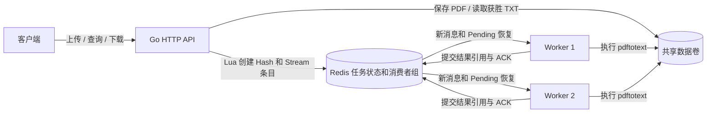

# TaskFlow · Go 与 Redis Streams 异步任务调度

TaskFlow 接收文本型 PDF，立即返回任务 ID，并通过 Redis Streams 将转换任务分发给多个 Go Worker。客户端可以查询状态并下载 UTF-8 文本。项目重点验证消息重投递、执行者失效、过期结果隔离和并发上传。

技术栈包含 Go 标准库、Redis Streams、Lua、Poppler、Docker Compose 和 GitHub Actions。

## 架构



## 快速启动

在项目根目录用 PowerShell 和 Docker Desktop 运行以下命令。首次构建需要访问容器镜像和 Debian 软件源。

```powershell
.\scripts\start.ps1
.\scripts\demo.ps1
docker compose logs --tail=100 api worker
```

启动脚本默认启动两个 Worker。用 `.\scripts\start.ps1 -Workers 4` 调整并发。演示使用 [示例 PDF](examples/sample.pdf)，默认下载到 `result.txt`，预期内容见 [示例文本](examples/sample.txt)。停止环境使用 `docker compose down`，数据卷会保留。

## HTTP API

| 方法 | 路径 | 响应 |
| --- | --- | --- |
| POST | `/tasks` | 上传 multipart 字段 `file`，返回 `202`、任务 ID 和 `Location` |
| GET | `/tasks/{id}` | 返回任务状态、尝试次数、时间戳和可用结果链接 |
| GET | `/tasks/{id}/result` | 下载 UTF-8 文本，结果未成功时返回 `409` |
| GET | `/tasks/{id}/download` | 与结果接口等价，兼容旧客户端 |
| GET | `/health` | API 进程存活 |
| GET | `/ready` | 检查 Redis PING 和数据目录 |
| GET | `/metrics` | Prometheus 文本格式的终态计数、状态处理延迟和队列积压 |

```powershell
curl.exe http://127.0.0.1:8080/ready
curl.exe -F "file=@examples/sample.pdf" http://127.0.0.1:8080/tasks
$taskId = '<返回的任务 ID>'
curl.exe "http://127.0.0.1:8080/tasks/$taskId"
curl.exe -o result.txt "http://127.0.0.1:8080/tasks/$taskId/result"
```

上传上限为 20 MiB。API 校验 PDF 签名，实际解析由 Poppler 完成。API 返回 `X-Request-ID`，错误正文使用 `code` 和 `error` 字段。常见错误包括无效请求 `400`、超限 `413`、找不到任务 `404` 和 Redis 不可用 `503`。

## 执行、恢复与并发

1. API 流式保存 PDF，Lua 在 Redis 中连续执行入队和状态初始化。
2. 每个 Worker 进程同一时间执行一个任务。阻塞读取和恢复扫描共享一个循环，通过多个进程增加并发。
3. Worker 用 Lua 领取执行令牌和带截止时间的租约。转换输出经同目录重命名后，仍需通过 Redis 的令牌与截止时间校验才能对用户可见。
4. 成功和最终失败都会在对应脚本中更新终态并确认消息。失败可重试时会发布新消息。每次领取都消耗预算，默认最多三次。
5. Worker 崩溃后，其他 Worker 从 Pending Entries List 领取空闲消息。仍有效的租约会让消息继续留在 PEL，直到提交成功或后续接管。

状态为 `queued → running → succeeded / failed`，可重试失败会回到 `queued`。本项目在队列数据保留且依赖恢复的条件下提供至少一次投递。重复执行可能发生，成功的结果引用只能由有效持有者提交。详情见 [架构](docs/architecture.md) 和 [可靠性](docs/reliability.md)。

## 测试和实测

Linux 或 WSL 环境需安装 Go、Redis、Poppler 和 Python 3。集成测试会启动自己的 Redis 进程。

```bash
go build ./...
go vet ./...
test -z "$(gofmt -l cmd internal)"
TASKFLOW_INTEGRATION=1 go test -count=1 ./...
TASKFLOW_INTEGRATION=1 go test -race -count=1 ./...
python3 scripts/failover.py
python3 scripts/benchmark.py --repeats 2
```

实测在 WSL Ubuntu 24.04，Redis 7.0.15 和 Poppler 24.02.0 上完成。故障脚本在另一 Worker 提前接管 Pending 消息后强制杀死原进程，任务第 2 次尝试成功，下载内容与样例逐字节相同。另有集成测试直接验证过期持有者无法替换下载结果。

| Worker | 完成吞吐量（任务/秒，两轮范围） | P95（ms，两轮范围） |
| --- | ---: | ---: |
| 1 | 60.70–69.59 | 2059–2412 |
| 2 | 140.50–140.85 | 997–1000 |
| 4 | 205.76–241.12 | 513–630 |
| 8 | 322.91–373.47 | 286–324 |

每轮 160 份固定 32 页 PDF，端到端错误率均为 0%。这些是指定样本和硬件上的短批次结果。完整测量口径、上传优化前后对照和原始数据见 [压测报告](docs/benchmark.md)。Docker Compose 配置已通过校验，Docker 容器运行证据见 [工程验收](docs/validation.md)。

## 适用范围

当前是单机共享卷和单 Redis 部署。仅支持文本型 PDF，扫描件需要外部 OCR。任务和消息历史仍需要运维规划保留策略。部署到多机时需要共享对象存储或等价服务，同时补齐持久化、访问控制和生命周期管理。更多限制与演进见 [可靠性说明](docs/reliability.md)。

## 项目结构

```text
cmd/                 API、Worker、离线文件核对
internal/api/         上传、状态查询、下载、指标
internal/tasks/       Redis 状态机、Streams、时间戳和指标
internal/worker/      消费循环、执行与结果提交
internal/convert/     Poppler 适配
internal/redisresp/   Redis RESP2 客户端
internal/integration/ 真实 Redis 和 Poppler 集成验证
examples/             示例 PDF、预期输出
scripts/              启动、演示、故障恢复、压测
docs/                 架构、可靠性、压测、验收、面试和简历
.github/workflows/    CI 流水线
```

[面试问答](docs/interview.md) · [简历素材](docs/resume.md)
